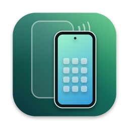
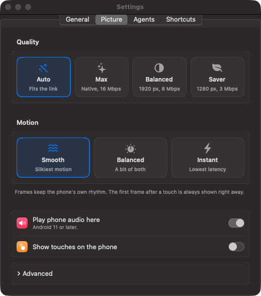
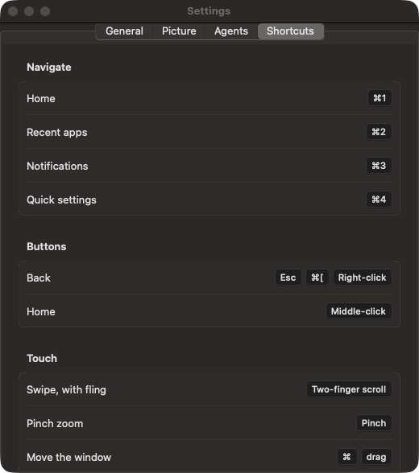

<p align="center">
  
</p>

# Android Mirroring

Use your Android phone from a native Mac window. Pair over wireless ADB or plug
in USB, then use your keyboard, mouse, and trackpad to control the phone. The
bundled `droidctl` CLI and MCP server give agents the same live screen and controls.

Built with Swift, AppKit, SwiftUI, VideoToolbox, and Metal. No Electron or external
Swift packages.

## What it does

- Mirrors video with hardware H.265 or H.264 decoding and display-paced Metal
  rendering. Automatic frame rate follows the phone on fast links, up to 120 fps.
- Sends clicks, drags, trackpad scrolling, pinch gestures, keyboard input, and
  Unicode text to Android. The phone can stay in use while mirroring.
- Plays phone audio on the Mac, shares the clipboard, and forwards notifications.
  You can turn these off individually.
- Installs dropped APKs and copies other dropped files to the phone's Downloads.
- Reconnects across known USB, Wi-Fi, and Tailscale paths, with adaptive quality.
- Gives agents screenshots, local OCR, taps, swipes, app launch, accessibility
  queries, file transfers, and ADB shell access, even when the window is hidden.

The phone can turn its physical display off while the stream continues. This is
separate from locking Android and does not bypass the phone's authentication.

## Screenshots

Screenshots of the running Mac app. No personal phone content is included.

| Picture settings | Keyboard and mouse |
| --- | --- |
|  |  |

## Download the app

[Download the precompiled DMG for Apple silicon](https://github.com/aaditagrawal/Android-Mirroring/releases/download/v1.0.1/Android-Mirroring-1.0.1-arm64.dmg).
Open it and drag **Android Mirroring** into **Applications**. Install ADB for
pairing with `brew install --cask android-platform-tools`, then open the app.
No Xcode or Swift toolchain is needed for this download.

This binary release supports Apple silicon Macs running macOS 14 or later.
It is ad-hoc signed and **not Apple-notarized**, so macOS may block the downloaded
app. [Releases](https://github.com/aaditagrawal/Android-Mirroring/releases) include
SHA-256 checksums and an alternative ZIP. Intel users can build from source.

## Build and install

You need macOS 14 or later, a Swift 6 or later toolchain, and Android platform
tools. Install Xcode Command Line Tools with `xcode-select --install`, then:

```sh
git clone https://github.com/aaditagrawal/Android-Mirroring.git
cd Android-Mirroring
brew install --cask android-platform-tools
scripts/build-app.sh --install
open -a "Android Mirroring"
```

The script builds a release app, verifies the bundled Android payloads, signs it
locally, and copies it to `/Applications`, or `~/Applications` if necessary. Omit
`--install` to build only into `build/Android Mirroring.app`. An Android SDK is
not required unless you change the relay.

Source builds use ad-hoc signing too. The app has no automatic update service.

## Homebrew

Install the precompiled app through the project's Homebrew tap:

```sh
brew tap aaditagrawal/android-mirroring https://github.com/aaditagrawal/Android-Mirroring
brew install --cask aaditagrawal/android-mirroring/android-mirroring
```

The cask installs the app, `droidctl`, and Android platform tools. It contains the
same ad-hoc signed app as the DMG. The [Homebrew guide](docs/homebrew.md) also
covers building from `HEAD`, agent setup, upgrades, and tap trust prompts.

## Connect your phone

1. Enable Developer options and USB debugging on Android. For wireless pairing,
   Android 11 or later also needs **Wireless debugging**, with phone and Mac on
   the same Wi-Fi network during pairing.
2. Open the app's **Phones** window with **Shift-Command-P**. Scan its pairing QR
   code from Android's Wireless debugging screen, or enter the pairing address
   and code shown by the phone. A pairing port and a connection port can differ.
3. Alternatively, attach USB and accept the debugging authorization prompt.
   Select the phone to start mirroring.

The app remembers known endpoints and reconnects. For Tailscale, the phone needs
a reachable ADB endpoint; installing Tailscale alone does not enable remote ADB.
See [connection and troubleshooting](docs/connections.md) for changing ports,
remote ADB servers, and authorization problems.

Audio forwarding needs Android 11 or later. Codec, refresh rate, audio capture,
and virtual-display support vary by phone. Protected content may appear black.

## Give an agent access

Add this to an MCP client's configuration, adjusting the app path if needed:

```json
{
  "mcpServers": {
    "android": {
      "command": "/Applications/Android Mirroring.app/Contents/MacOS/droidctl",
      "args": ["mcp"]
    }
  }
}
```

Settings → Agents has copyable setup commands and an option to install `droidctl`
into `/usr/local/bin`. After that:

```sh
droidctl status
droidctl screenshot --png -o phone.png
droidctl launch com.android.settings
droidctl tap-text "Search"
droidctl type "display"
droidctl text
```

MCP actions return a screenshot after waiting for the screen to settle. Text
recognition runs locally on the Mac. Coordinates use the most recent screenshot,
scaled to a 1280-pixel long edge by default.

Agent access includes shell execution, clipboard access, file transfer, and
optional unlocking with a saved PIN. Use trusted clients. Read the
[agent guide](docs/agents.md) and [security notes](SECURITY.md) before connecting
one to your phone.

## Everyday controls

| Input | Action |
| --- | --- |
| Click or drag | Tap or swipe |
| Two-finger scroll / pinch | Scroll / zoom |
| Escape, Command-[, right-click | Back |
| Command-1 / Command-2 | Home / recent apps |
| Command-3 / Command-4 | Notifications / quick settings |
| Command-Up / Command-Down | Volume |
| Command-R / Command-L | Rotate / lock |
| Option-Command-O | Toggle the phone display |
| Shift-Command-S | Save a screenshot to Desktop |

The Settings window includes the full shortcuts list.

## Development

```sh
swift build
scripts/test.sh
swift run -c release mirror-selftest
scripts/build-app.sh
scripts/check-cli.sh
```

The normal checks run without a phone. See the [development guide](docs/development.md),
[architecture](docs/architecture.md), and [contribution guide](CONTRIBUTING.md).
Maintainers can use the [GitHub publication guide](docs/publishing.md) for the
first push and release preparation.

## License and credits

Original code is [MIT licensed](LICENSE). The bundled
[scrcpy v5.0.1 server](https://github.com/Genymobile/scrcpy/releases/tag/v5.0.1)
by Genymobile and its contributors is Apache-2.0 licensed. See
[third-party notices](THIRD_PARTY_NOTICES.md) for its source, binary checksum, and
license. Development uses Codex; assisted commits include a co-author trailer.

Android Mirroring is an independent project, unaffiliated with Apple, Google,
Genymobile, or Tailscale.
